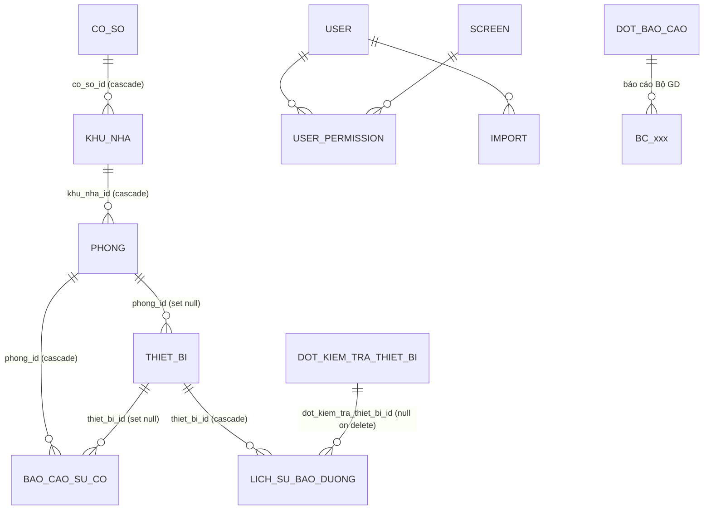
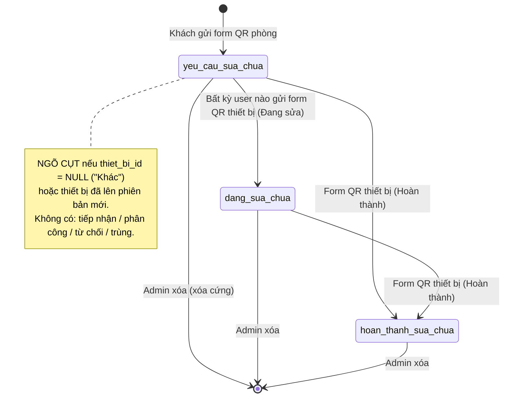
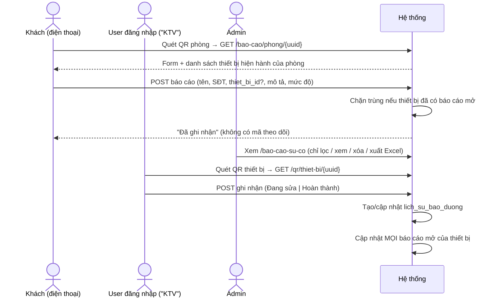

# BÁO CÁO RÀ SOÁT HỆ THỐNG QLCSVC (Laravel 8 + React + Inertia)

> Ngày rà soát: 13/11/2026 · Phạm vi: toàn bộ `routes/`, `app/`, `database/migrations/`, `resources/js/components/`, cấu hình.
> Rà soát chỉ đọc mã nguồn, **chưa chạy thử trên môi trường thật**. Số dòng tính theo commit `c2b0e9d`.

---

## 1. Tóm tắt tổng quan

**Đánh giá chung:** Kiến trúc có tổ chức (Controller → Service → Repository), phân quyền theo màn hình gắn ở tầng route, form công khai có honeypot + throttle, import Excel chạy nền có theo dõi tiến độ, có cơ chế phiên bản hóa dữ liệu (`hien_hanh`/`lich_su`). Tuy vậy **luồng nghiệp vụ sự cố chưa khép kín** và **mô hình phân quyền có lỗ hổng leo thang đặc quyền**.

**Điểm mạnh**
- QR dùng UUID ngẫu nhiên (`qr_token`), không dùng ID tuần tự → không đoán được URL phòng/thiết bị.
- `role` của User không nằm trong `$fillable`; `is_active` của đợt kiểm tra cũng được gán tường minh.
- Các thao tác versioning, kích hoạt đợt kiểm tra, đồng bộ quyền đều chạy trong `DB::transaction`.
- Có index hiệu năng cho các truy vấn chính (`2026_07_23_000001_add_performance_indexes.php`).

**5 vấn đề đáng lo nhất**
1. **Leo thang lên admin**: ai có quyền màn hình "Người dùng" (tạo/sửa) thì tạo được tài khoản admin hoặc đổi mật khẩu admin; ai có quyền sửa "Phân quyền" thì tự cấp mọi quyền cho chính mình (#01, #02).
2. **Mọi tài khoản đăng nhập đều ghi nhận sửa chữa được** qua QR thiết bị và qua đó đóng toàn bộ sự cố của thiết bị đó, vì route không gắn quyền (#03).
3. **Sự cố rơi vào ngõ cụt**: báo cáo không chọn thiết bị ("Khác") hoặc gắn với thiết bị đã lên phiên bản mới sẽ **không bao giờ đóng được**, vì admin không có thao tác đổi trạng thái (#04).
4. **Lên phiên bản mới là đổi QR**: mã QR đã in dán trên phòng/thiết bị trả về 404, lịch sử sửa chữa và báo cáo bị tách khỏi bản ghi mới (#06).
5. **Xóa cứng dây chuyền**: xóa một cơ sở thì toàn bộ khu nhà, phòng và **báo cáo sự cố** bị xóa theo; xóa thiết bị thì mất lịch sử bảo dưỡng (#07).

---

## 2. Toàn cảnh hệ thống

### 2.1 Vai trò người dùng (thực tế trong code)

Hệ thống **chỉ có 2 role**: `admin` và `user` (`users.role`, migration `2025_12_13_000001`). Không có role riêng cho kỹ thuật viên, giảng viên hay sinh viên. Quyền của `user` được cấp **theo từng màn hình** (`user_permissions`: `can_view/create/edit/delete/import/export/regenerate_qr`).

| Vai trò | Cách xác định | Quyền |
|---|---|---|
| Khách (quét QR phòng) | Không đăng nhập | Xem thông tin phòng + danh sách thiết bị, gửi báo cáo sự cố (`/bao-cao/phong/{token}`) |
| User đã đăng nhập (bất kỳ) | `auth` | Dashboard, **ghi nhận sửa chữa qua QR thiết bị**, AI insight, xem import của mình |
| User có quyền màn hình X | `permission:X,can_*` | CRUD theo từng màn hình |
| Admin | `role = 'admin'` | Bỏ qua mọi kiểm tra quyền (`CheckPermission.php:28`) |

"Kỹ thuật viên" trên thực tế là **bất kỳ ai đăng nhập được**.

### 2.2 Thực thể chính & quan hệ

Cơ sở, khu nhà, phòng và thiết bị đều có **versioning**: `trang_thai_du_lieu` (`hien_hanh`/`lich_su`), `phien_ban`, `ban_ghi_goc_id`, `hieu_luc_tu/den`. Mỗi lần "lưu phiên bản" sinh ra **một bản ghi mới với ID mới**.

### 2.3 State machine

**Báo cáo sự cố (`bao_cao_su_cos.trang_thai`)**

**Lịch sử bảo dưỡng (`lich_su_bao_duongs.trang_thai`)**: `chua_thuc_hien` ↔ `dang_thuc_hien` ↔ `hoan_thanh`. Form admin cho chuyển **tự do theo mọi chiều**, kể cả `hoan_thanh → chua_thuc_hien`.

**Dữ liệu phiên bản**: `hien_hanh → lich_su` (một chiều, khi lưu phiên bản mới). Không có trạng thái "thanh lý".

**Đợt kiểm tra thiết bị**: `inactive ↔ active` (tối đa 1 đợt active); chỉ xóa được khi inactive. Không kiểm tra `ngay_ket_thuc`.

**Import**: `pending → processing → completed | failed`; `processing → pending` (tự re-dispatch sau 30 giây, xem #14).

**Thiết bị (`thiet_bis.trang_thai`)**: `tot | can_sua_chua | hu_hong`, **chỉ đổi bằng tay**, không gắn với luồng sự cố.

### 2.4 Luồng nghiệp vụ chính

Các luồng còn lại: CRUD + import Excel cho cơ sở/khu nhà/phòng/thiết bị, quản lý QR (in/tạo lại), đợt kiểm tra, thống kê (snapshot + Pusher realtime), xuất báo cáo Bộ GD, AI insight (Gemini).

---

## 3. Bảng vấn đề

Mức độ: 🔴 Nghiêm trọng · 🟠 Cao · 🟡 Trung bình · 🟢 Thấp

| Mã | Mức | Nhóm | Vị trí | Mô tả | Kịch bản tái hiện | Đề xuất sửa |
|---|---|---|---|---|---|---|
| #01 | 🔴 | Phân quyền | `app/Http/Controllers/UserController.php:53,96`; `app/Services/UserService.php:61,74-106` | User không phải admin nhưng có quyền `nguoi-dung` (create/edit) được phép đặt `role=admin` và đổi mật khẩu của **bất kỳ ai, kể cả admin**. | User A được cấp quyền "Thêm người dùng" → tạo tài khoản mới với `role=admin` → đăng nhập bằng tài khoản đó là có toàn quyền. Hoặc A có quyền sửa → đổi mật khẩu của admin. | Chỉ admin mới được gán `role=admin` và sửa tài khoản admin. Kiểm tra ở Service (`if (!auth()->user()->isAdmin() && ($data['role']==='admin' \|\| $target->isAdmin())) throw`). |
| #02 | 🔴 | Phân quyền | `app/Http/Controllers/PermissionController.php:61-69`; `app/Http/Requests/Permission/UpdatePermissionRequest.php:14` | Người có `phan-quyen,can_edit` sửa được quyền của **chính mình**, nên tự cấp mọi quyền. | User B chỉ được cấp quyền sửa phân quyền → POST `/phan-quyen/{id_của_B}/permissions` với tất cả quyền = true → có toàn quyền mọi màn hình. | Chặn `$user->id === auth()->id()` khi người sửa không phải admin. Tốt nhất là chỉ admin mới được sửa phân quyền. |
| #03 | 🔴 | Phân quyền / Logic | `routes/web.php:182-183`; `BaoCaoSuCoController.php:89-152` | Route ghi nhận sửa chữa qua QR thiết bị chỉ yêu cầu `auth`, **không gắn quyền**. Mọi tài khoản (kể cả tài khoản chỉ được xem thống kê) đều tạo/sửa được lịch sử bảo dưỡng và đóng mọi sự cố của thiết bị. | Tài khoản chỉ có quyền xem → mở link QR thiết bị (in dán công khai trên thiết bị) → chọn "Hoàn thành" → tất cả báo cáo của thiết bị chuyển sang `hoan_thanh_sua_chua`. | Gắn `permission:lich-su-bao-duong,can_create` (hoặc tạo màn hình/quyền "ghi nhận sửa chữa"). |
| #04 | 🔴 | Logic | `app/Repositories/BaoCaoSuCoRepository.php:116-138`; `resources/js/components/BaoCaoSuCo/Index.jsx:64,143` | Báo cáo chỉ được đóng thông qua `thiet_bi_id`. Báo cáo chọn "Khác" (`thiet_bi_id=NULL`) hoặc gắn với ID thiết bị cũ (sau khi lên phiên bản) sẽ **mãi ở trạng thái `yeu_cau_sua_chua`**. Trang admin chỉ có lọc/xem/xóa/xuất, không có nút đổi trạng thái. Thống kê "khẩn cấp chưa xử lý" vì vậy tăng mãi. | Khách báo "Máy lạnh chảy nước", chọn "Khác" → không có cách nào đóng báo cáo, ngoài việc xóa. | Thêm action admin `PATCH /bao-cao-su-co/{id}/trang-thai` (tiếp nhận / đang xử lý / hoàn thành / từ chối / trùng), kiểm tra chuyển trạng thái hợp lệ ở backend, ghi người xử lý và ghi chú. |
| #05 | 🟠 | Bảo mật / Logic | `app/Http/Requests/BaoCaoSuCo/StoreBaoCaoSuCoRequest.php:19`; `BaoCaoSuCoController.php:59-63` | `thiet_bi_id` chỉ được kiểm tra `exists:thiet_bis,id`, **không kiểm tra thiết bị thuộc phòng của token và còn `hien_hanh`**. | Khách sửa body POST thành `thiet_bi_id=<thiết bị phòng khác>` → báo cáo gắn sai phòng. Gửi ID của bản ghi `lich_su` → báo cáo không bao giờ đóng được (xem #04). Câu báo lỗi "đã có yêu cầu sửa chữa" còn giúp dò được thiết bị nào đang hỏng. | `Rule::exists('thiet_bis','id')->where('phong_id',$phong->id)->where('trang_thai_du_lieu','hien_hanh')`. |
| #06 | 🟠 | Dữ liệu | `app/Services/ThietBiService.php:144-152`; `app/Services/PhongService.php:187-199`; `app/Models/ThietBi.php:65`; `app/Models/Phong.php:50` | Lưu phiên bản mới tạo bản ghi mới mà không chép `qr_token`, nên `boot()` sinh UUID mới. **QR đã in dán trả về 404.** Lịch sử bảo dưỡng và báo cáo sự cố vẫn trỏ về ID cũ: trang QR thiết bị hiển thị "0 lần sửa", báo cáo cũ không đóng được, còn kiểm tra trùng trên ID mới thì cho gửi trùng. | Admin sửa giá trị thiết bị bằng "Lưu phiên bản mới" → quét QR dán trên máy → 404. | Chép `qr_token` sang bản mới (set `null` ở bản cũ để không vi phạm unique), hoặc tra QR theo `ban_ghi_goc_id`. Truy vấn lịch sử/báo cáo theo `ban_ghi_goc_id`, hoặc chuyển FK sang bản mới trong cùng transaction. *(Xem "Cần xác nhận" C1.)* |
| #07 | 🟠 | Dữ liệu | `database/migrations/2024_01_01_000002…:18`, `…000003…:18`, `…000004…:18`, `…000006…:18`, `2026_02_25_000008…:26`; `CoSoService::delete`, `KhuNhaService::delete`, `PhongService.php:157-165` | Xóa cứng kèm FK cascade: xóa cơ sở → xóa khu nhà → xóa phòng → **xóa báo cáo sự cố**; thiết bị bị mồ côi (`phong_id=NULL`). Xóa thiết bị → xóa lịch sử bảo dưỡng. Không có bước kiểm tra "còn dữ liệu con" và không có soft delete. | Admin bấm xóa nhầm một khu nhà → mất toàn bộ phòng và lịch sử sự cố của khu nhà đó, không khôi phục được. | Dùng `SoftDeletes` cho các thực thể chính, hoặc chặn xóa khi còn dữ liệu con (`restrict`) và thay bằng trạng thái "ngừng sử dụng / thanh lý". |
| #08 | 🟠 | Bảo mật | `app/Http/Middleware/TrustProxies.php:15`; `routes/web.php:32,37` | `$proxies='*'` khiến `$request->ip()` lấy từ `X-Forwarded-For` do client gửi lên. Throttle theo IP ở form công khai và ở login **có thể bị vượt qua** nếu app không đứng sau reverse proxy ghi đè header này. | Script gửi POST `/login` với `X-Forwarded-For` ngẫu nhiên mỗi lần → dò mật khẩu không giới hạn; spam báo cáo không giới hạn. | Khai báo đúng IP proxy tin cậy. Throttle login theo `email+ip`. Thêm captcha cho form công khai. |
| #09 | 🟠 | Logic / Dữ liệu | `BaoCaoSuCoController.php:117,135-145`; `BaoCaoSuCoRepository.php:128-138` | Khi thiết bị có phiên `dang_thuc_hien`, form QR **ghi đè** bản ghi đó (cả `nguoi_thuc_hien`, ngày, nội dung) bất kể ai tạo. Việc ghi lịch sử và cập nhật báo cáo không nằm trong transaction. `nguoi_hoan_thanh` bị gán bằng người "đang sửa". | KTV A ghi "Đang sửa". KTV B quét cùng QR rồi gửi → tên A bị thay bằng B, nội dung A mất. Nếu bước 2 lỗi, lịch sử đã lưu nhưng báo cáo không đổi trạng thái. | Bọc trong `DB::transaction`. Lưu `user_id` người thực hiện (FK) thay vì chuỗi tên; chỉ người tạo phiên (hoặc admin) được cập nhật; thêm cột `nguoi_tiep_nhan` riêng. |
| #10 | 🟠 | Logic | `app/Repositories/ThietBiRepository.php:122`; `LichSuBaoDuongController.php:67,99`; `LichSuBaoDuongService.php:69-81` | (a) Form thêm/sửa lịch sử bảo dưỡng chỉ liệt kê thiết bị `trang_thai='tot'`, nên **không chọn được thiết bị đang hỏng** để ghi sửa chữa. (b) Ghi lịch sử "hoàn thành" từ form admin không đồng bộ báo cáo sự cố (chỉ luồng QR làm việc này). | Thiết bị hỏng → admin vào "Thêm lịch sử bảo dưỡng" → thiết bị không có trong danh sách. | Bỏ điều kiện `tot` (chỉ giữ `hien_hanh`). Đưa logic "hoàn thành → đóng báo cáo" vào `LichSuBaoDuongService` để cả hai luồng dùng chung. |
| #11 | 🟠 | Logic | `app/Http/Requests/ThietBi/*Request.php` (`in:tot,can_sua_chua,hu_hong`); `BaoCaoSuCoService.php:39-48` | Trạng thái thiết bị không tự đổi khi có báo cáo hoặc khi sửa xong. Không có trạng thái "thanh lý / ngừng sử dụng", nên thiết bị đã bỏ đi vẫn hiện trong form QR công khai và vẫn nhận báo cáo. | Báo cáo hỏng → thiết bị vẫn hiện "Tốt" trên danh sách và thống kê. | Thêm `thanh_ly`/`ngung_su_dung` và lọc chúng khỏi form QR. Tự đổi `can_sua_chua` khi có báo cáo mở, về `tot` khi hoàn thành (hoặc hỏi KTV). |
| #12 | 🟠 | Code / UX | `routes/web.php:145`; `LichSuBaoDuongController.php:144` | Route `thiet-bi.lich-su-bao-duong` render `LichSuBaoDuong/Show`, nhưng **file `resources/js/components/LichSuBaoDuong/Show.jsx` không tồn tại** và cũng không có link nào trỏ tới route này. | Truy cập `/thiet-bi/1/lich-su-bao-duong` → lỗi JS "Cannot find module", màn hình trắng. | Tạo trang Show (lịch sử sửa chữa của một thiết bị, gộp theo `ban_ghi_goc_id`) và gắn link từ danh sách thiết bị, hoặc xóa route. |
| #13 | 🟡 | Dữ liệu | `BaoCaoSuCoService.php:52-62`; `database/migrations/2026_02_25_000001_add_versioning_columns.php:49-58` | (a) Chống trùng báo cáo theo kiểu check-then-insert, không lock → 2 người gửi cùng lúc tạo 2 báo cáo. (b) Unique của `ma_co_so/ma_khu_nha/ma_phong/ma_thiet_bi` đã bị bỏ ở DB, chỉ còn kiểm tra ở validation → import song song hoặc submit đôi tạo trùng mã. | Hai sinh viên cùng bấm gửi trong một giây → 2 báo cáo mở cho cùng thiết bị. | Dùng `lockForUpdate` trong transaction. Với mã: thêm cột sinh `is_current` (`NULL` khi lịch sử) + unique `(ma_x, is_current)` để có unique theo phạm vi `hien_hanh` trên MySQL. |
| #14 | 🟡 | Dữ liệu | `app/Models/Import.php:77`; `app/Jobs/ProcessExcelImport.php:96`; `app/Services/ImportService.php:36-40` | Import đang `processing` mà quá 30 giây không cập nhật `updated_at` thì bị coi là kẹt và **dispatch lại**, trong khi job không có heartbeat. Nếu queue `imports` có từ 2 worker trở lên, cùng một file sẽ chạy song song → dữ liệu trùng (DB không có unique, xem #13). Khóa "một import tại một thời điểm" cũng là check-then-act. | Import 5.000 thiết bị (> 30 giây), người dùng mở trang → `status` gọi cleanup → job thứ hai chạy song song. | Cập nhật heartbeat (`touch()`) sau mỗi chunk; nâng ngưỡng; dùng `Cache::lock` hoặc `ShouldBeUnique` cho job. |
| #15 | 🟡 | Logic | `app/Models/BaoCaoSuCo.php:43-52`; `BaoCaoSuCoRepository.php:41-48` | "Đợt kiểm tra" của báo cáo được suy ra từ lịch sử bảo dưỡng **mới nhất của thiết bị**, không phải lần sửa ứng với báo cáo đó. Bộ lọc `dot_id` khớp mọi báo cáo của thiết bị từng có sửa chữa trong đợt. | Thiết bị sửa ở đợt 1, rồi báo hỏng lại và sửa đột xuất → báo cáo cũ của đợt 1 hiển thị sai đợt. | Lưu `lich_su_bao_duong_id` (hoặc `dot_kiem_tra_thiet_bi_id`) trực tiếp trên báo cáo khi đóng. |
| #16 | 🟡 | Bảo mật | `routes/web.php:245-247`; `app/Services/AiInsightService.php:42`; `AiInsightController.php:62` | Endpoint AI không gắn quyền: mọi user tiêu tốn quota Gemini (5 lần/phút/người). Lỗi trả nguyên `getMessage()`. API key nằm trên query string (dễ lọt vào log của proxy/HTTP client). | Một tài khoản bất kỳ chạy script gọi `/ai/insight` liên tục với payload lớn. | Gắn `permission:thong-ke,can_view`, giới hạn kích thước `currentData`, gửi key qua header `x-goog-api-key`. |
| #17 | 🟡 | Phân quyền | `routes/web.php:177` | `POST /thong-ke/recalculate` (tính lại toàn bộ thống kê, tác vụ nặng) chỉ cần quyền **xem**. | User chỉ có quyền xem bấm "tính lại" liên tục → tải DB tăng cao. | Chuyển sang `can_edit` hoặc chỉ admin, thêm throttle. |
| #18 | 🟡 | Bảo mật | 54 chỗ `$e->getMessage()` trong `app/Http/Controllers/*` (vd `ThietBiController.php:73,122`) | Thông báo lỗi trả thẳng chi tiết exception (có thể chứa câu SQL, tên bảng) cho người dùng. | Gửi dữ liệu gây lỗi DB → flash hiển thị `SQLSTATE[...]`. | Log chi tiết, hiển thị thông báo chung; chỉ để lộ message của exception nghiệp vụ (`ServiceException`). |
| #19 | 🟡 | Hiệu năng | 12 chỗ `(int)$request->input('per_page', …)` (vd `BaoCaoSuCoController.php:159`) | `per_page` không có giới hạn trên. | `/thiet-bi?per_page=1000000` → tải toàn bảng kèm eager load, dễ gây treo. | `min(max((int)…,1),100)`. |
| #20 | 🟡 | Hiệu năng | `app/Http/Middleware/HandleInertiaRequests.php:85-86`; `app/Models/User.php:130-138` | Mỗi request: vòng `$user->permissions` gọi lazy `$permission->screen` (N+1). `hasPermission()` tốn 2 query mỗi lần gọi. | User có 15 màn hình → khoảng 17 query chỉ để dựng props chung. | `$user->permissions()->with('screen')`; cache quyền theo user (xóa cache khi `syncPermissions`). |
| #21 | 🟡 | Hiệu năng | `ThietBiService.php:154` (trong transaction), các `onEntityChanged()` | Tính lại snapshot thống kê **đồng bộ** sau mỗi thao tác CRUD, có chỗ chạy ngay trong transaction (broadcast trước khi commit). | Sửa liên tiếp nhiều thiết bị → mỗi request chậm vì phải chạy lại thống kê. | Dispatch job tính snapshot (debounce) sau commit (`DB::afterCommit`). |
| #22 | 🟡 | UX | `resources/js/components/Layout/MainLayout.jsx:86,294` | Sidebar mặc định mở rộng 210px và `marginLeft: 210` trên mọi kích thước màn hình. Trang QR thiết bị (KTV dùng điện thoại) cũng dùng layout này → trên màn 360px, nội dung chỉ còn khoảng 150px. | KTV quét QR bằng điện thoại → form bị bóp hẹp, phải tự thu sidebar. | Dùng `breakpoint="md"` + `onBreakpoint` để tự thu, hoặc dùng Drawer trên mobile; có thể cho trang QR thiết bị một layout tối giản. |
| #23 | 🟡 | UX | `resources/js/components/BaoCao/PhongForm.jsx:165-185, 52-79` | Người báo không nhận mã theo dõi nên không xem được tiến độ. Dropdown không cho biết thiết bị nào đã có báo cáo mở, nên người dùng điền xong mới bị báo lỗi. Không có upload ảnh. | Sinh viên chọn máy chiếu đã có người báo → gửi → báo lỗi, công điền form bị bỏ phí. | Trả mã tra cứu và tạo trang `/bao-cao/tra-cuu/{ma}`; đánh dấu "đã có người báo – đang xử lý" ngay trong dropdown. |
| #24 | 🟢 | UX | `PhongForm.jsx:40-42` | Chặn gửi trong 3 giây đầu bằng `return` im lặng, không có phản hồi nào. | Người dùng điền nhanh hoặc autofill, bấm "Gửi" → không có gì xảy ra. | Hiện thông báo, hoặc chuyển kiểm tra thời gian về backend (timestamp đã ký). |
| #25 | 🟢 | Logic | `BaoCaoSuCoController.php:96`; `LichSuBaoDuongService.php:136-156` | Backend nhận `ngay_bao_duong` ở tương lai (frontend chặn nhưng backend không). Ghi lịch sử lùi ngày sẽ **ghi đè** `ngay_bao_duong_cuoi` bằng ngày cũ hơn, kéo `ngay_bao_duong_tiep_theo` lùi theo. | Nhập bổ sung lần bảo dưỡng năm ngoái → thiết bị bị báo "đến hạn bảo dưỡng" sai. | `before_or_equal:today`; chỉ cập nhật khi ngày mới > `ngay_bao_duong_cuoi` hiện tại. |
| #26 | 🟢 | Bảo mật | `ThietBiRepository.php:363`; `BaoCaoSuCoController.php:80-86` | Trang QR thiết bị đẩy **toàn bộ model** thiết bị (giá trị, serial, thông số, `qr_token`…) xuống client cho mọi user đăng nhập. | User không có quyền xem thiết bị vẫn thấy giá trị tài sản qua props. | Chỉ `select` các cột cần hiển thị. |
| #27 | 🟢 | Logic | `app/Repositories/DotKiemTraThietBiRepository.php:94` | Đợt active không đối chiếu `ngay_bat_dau/ngay_ket_thuc`, nên đợt đã hết hạn vẫn nhận sửa chữa "định kỳ". | Đợt kết thúc 30/6 nhưng quên tắt → tháng 9 vẫn ghi vào đợt đó. | Kiểm tra ngày khi `getActiveDot()`, hoặc tự hết hạn. |
| #28 | 🟢 | Code | Toàn dự án (`'yeu_cau_sua_chua'`, `'hien_hanh'`, `'tot'`…) | Trạng thái là magic string lặp lại ở PHP, JSX, SQL raw và migration. | Đổi tên một trạng thái → sót chỗ nào là sai chỗ đó (đã xảy ra qua 3 lần đổi enum của `bao_cao_su_cos`). | Laravel 8 + PHP ≥ 7.3: dùng class constants (hoặc Enum nếu nâng PHP 8.1), xuất ra frontend qua shared props. |
| #29 | 🟢 | Code | `PermissionController.php:74-82` (không có route); `User.php` `getPermissionForScreen/getViewableScreenIds/getAllPermissions`; `app/Models/Iphone.php`; `routes/api.php:17` | Code chết, không có chỗ nào gọi tới. | — | Xóa. |
| #30 | 🟢 | Cấu hình | `.env.example`; `tests/` | `.env.example` thiếu `GEMINI_API_KEY`, `REDIS_CLIENT` và chưa ghi rõ app cần queue redis + Pusher. Không có test nào ngoài ExampleTest. (`.env` không bị commit – tốt.) | Dev mới cài → AI và import nền không chạy, không rõ lý do. | Bổ sung biến môi trường vào `.env.example`; viết test cho phân quyền và luồng sự cố trước khi sửa các mục trên. |
| #31 | 🟢 | UX | `DashboardController.php` (catch → `redirect()->back()`) | Dashboard lỗi thì redirect về trang trước; nếu trang trước cũng là `/` thì thành vòng lặp redirect. | Snapshot hỏng → mở `/` → trình duyệt báo "too many redirects". | Render dashboard rỗng kèm thông báo lỗi. |

---

## 4. Luồng thiếu hoặc nên bổ sung

So với một hệ thống quản lý CSVC đại học thực tế:

1. **Tiếp nhận & phân công sự cố**: trạng thái `tiep_nhan`, `tu_choi`, `trung_lap`; giao cho một KTV cụ thể (`assigned_to`); KTV chỉ xử lý phiếu của mình. Đây là luồng lõi đang thiếu.
2. **Thông báo**: báo cho KTV hoặc quản lý khi có sự cố mới, nhất là mức `khan_cap` (đã có Pusher nhưng chỉ dùng cho thống kê và import).
3. **Theo dõi cho người báo**: mã tra cứu, trang xem trạng thái, tùy chọn nhận SMS/Zalo.
4. **Ảnh minh chứng** cho báo cáo và cho phiếu sửa chữa (kiểm tra MIME, giới hạn dung lượng, lưu ngoài `public/`).
5. **Vòng đời thiết bị**: thanh lý, điều chuyển phòng có lịch sử, bảo hành (ngày hết hạn, nhà cung cấp).
6. **Lịch sử sửa chữa theo thiết bị**: trang Show đang hỏng (#12), cần gộp theo `ban_ghi_goc_id` để không mất lịch sử qua các phiên bản.
7. **Bảo trì định kỳ chủ động**: đã tính `ngay_bao_duong_tiep_theo` nhưng chưa có scheduler (`Console/Kernel.php` rỗng), không nhắc việc và không tự sinh phiếu.
8. **Kiểm kê**: "Đợt kiểm tra" hiện chỉ để gắn nhãn cho phiếu sửa. Còn thiếu checklist kiểm kê theo phòng (có / thiếu / hỏng) và biên bản.
9. **Nhật ký thao tác (audit log)**: ai xóa báo cáo, ai đổi quyền, ai sửa giá trị tài sản. Hiện không có (có thể dùng `spatie/laravel-activitylog` hoặc một bảng tự viết).
10. **Báo cáo vận hành**: thời gian xử lý trung bình, số sự cố theo phòng/thiết bị, chi phí sửa chữa theo năm.
11. **Mượn/trả phòng và thiết bị**: chưa có. Cần hỏi nghiệp vụ trường có cần không.

---

## 5. Cần xác nhận

| # | Nội dung | Vì sao chưa chắc |
|---|---|---|
| C1 | "Lưu phiên bản mới" của thiết bị là **sửa thông tin** hay **thay thiết bị vật lý mới**? | Trang "Lịch sử thiết bị/Kho" gọi bản mới là "thiết bị thay thế", gợi ý đây là máy mới (khi đó đổi QR là hợp lý). Nhưng mã và serial lại được chép sang bản mới, tức vẫn là cùng một máy. Mức độ của #06 phụ thuộc câu trả lời này. |
| C2 | Có chủ ý cho **mọi user đăng nhập** ghi nhận sửa chữa không? | Có thể toàn bộ tài khoản đều là nhân viên kỹ thuật. Nếu vậy #03 giảm mức, nhưng vẫn nên có quyền riêng. |
| C3 | Dashboard hiển thị cho mọi user, trong khi kênh realtime `dashboard` yêu cầu `thong-ke,can_view` (`routes/channels.php:31-38`). | Không rõ dashboard có cố ý công khai nội bộ hay không. |
| C4 | Ghi một lần **sửa chữa** (không phải bảo dưỡng định kỳ) "hoàn thành" cũng reset chu kỳ bảo dưỡng (`LichSuBaoDuongService::create`). | Có trường dùng cách này, có trường thì không. |
| C5 | Throttle 5 lần/phút/IP cho form công khai. | Nếu cả campus đi qua NAT chung một IP thì người báo thật có thể bị chặn; ngược lại nếu có proxy đúng thì #08 không còn. Cần biết hạ tầng triển khai. |
| C6 | `.env` hiện có `APP_ENV=local`. | Không rõ đây là máy dev hay máy chạy thật. Nếu là production thì phải đặt `APP_ENV=production` (`APP_DEBUG` đang là `false` – tốt). |
| C7 | Báo cáo sự cố không chọn thiết bị ("Khác"). | Có thể chủ ý để admin xử lý ngoài hệ thống, nhưng khi đó số liệu vẫn kẹt (#04). |
| C8 | Xóa báo cáo sự cố là xóa cứng. | Có thể chủ ý để dọn spam, nhưng sẽ mất bằng chứng. Nên có trạng thái "spam/từ chối". |

---

## 6. Kế hoạch sửa đề xuất (theo thứ tự ưu tiên)

**Đợt 1 – Chặn lỗ hổng (nhỏ, làm ngay, ~1 ngày)**
1. #01, #02: chỉ admin được gán role admin, sửa tài khoản admin và sửa phân quyền (hoặc cấm tự sửa quyền của mình).
2. #03: gắn quyền cho route QR thiết bị.
3. #05: ràng buộc `thiet_bi_id` thuộc phòng và đang `hien_hanh`.
4. #08: cấu hình TrustProxies đúng; throttle login theo email+IP.
5. #12: tạo trang Show hoặc gỡ route.
6. Viết feature test cho 1–4 (hiện chưa có test).

**Đợt 2 – Khép kín luồng sự cố (~3–5 ngày)**
7. #04: action đổi trạng thái cho admin + kiểm tra chuyển trạng thái hợp lệ ở backend (dùng hằng số trạng thái, #28).
8. #09, #10: chuyển logic "ghi sửa chữa → cập nhật báo cáo" vào Service, bọc transaction, lưu `user_id`; bỏ lọc `tot`.
9. #06 (sau khi trả lời C1): giữ QR và lịch sử qua các phiên bản.
10. #11: trạng thái thanh lý + tự cập nhật trạng thái thiết bị.

**Đợt 3 – Toàn vẹn dữ liệu (~2–3 ngày)**
11. #07: soft delete / chặn xóa khi còn dữ liệu con.
12. #13, #14: unique theo phạm vi hiện hành ở DB, lock khi chống trùng, heartbeat cho import.
13. #15, #25, #27: sửa liên kết đợt kiểm tra và logic ngày bảo dưỡng.

**Đợt 4 – Hiệu năng & chất lượng**
14. #19, #20, #21: giới hạn `per_page`, eager load hoặc cache quyền, đưa snapshot ra queue.
15. #16, #17, #18: siết AI endpoint và recalculate, ẩn chi tiết exception.
16. #22, #23, #24: layout mobile, mã tra cứu cho người báo.
17. #26, #29, #30, #31: dọn code chết, `.env.example`, props thừa.

**Đợt 5 – Bổ sung tính năng (mục 4)**: phân công + thông báo, ảnh minh chứng, audit log, scheduler bảo trì định kỳ, kiểm kê.
